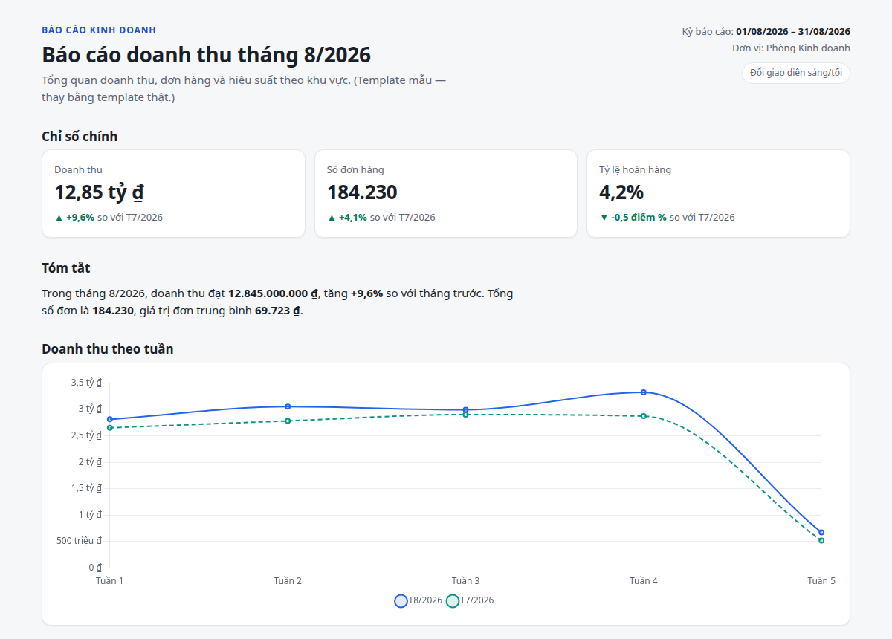
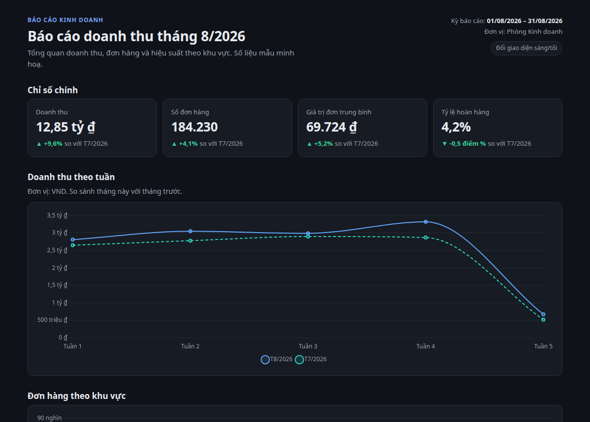
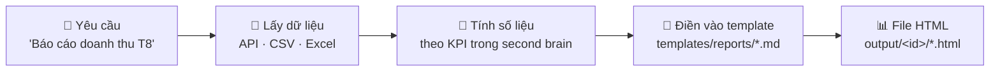

<div align="center">

# 📊 fw-bu · Báo cáo kinh doanh bằng Claude Code

**Mô tả báo cáo bằng tiếng Việt → nhận file HTML đẹp, số liệu chính xác, mở offline.**


<table>
  <tr>
    <td></td>
    <td></td>
  </tr>
</table>

</div>

## ✨ Tính năng

- 🧾 **Một file HTML tự chứa**: mở offline, gửi email được, tự đổi sáng/tối, in PDF A4 gọn gàng.
- 🇻🇳 **Chuẩn Việt Nam**: `12.845.000.000 ₫`, `12,85 tỷ ₫`, `+9,6%`, ngày `dd/mm/yyyy`, giờ Việt Nam.
- 📝 **Template riêng cho từng loại báo cáo** bằng Markdown: bạn quyết định bố cục, Claude điền số.
- 🔌 **Lấy dữ liệu từ API / CSV / Excel**: phân trang, cache, token nằm an toàn trong `.env`.
- 🧭 **Lên plan trước khi code** với OpenSpec (`/opsx:propose` → `/opsx:apply`).
- 🧠 **Second brain** trong Obsidian: lưu định nghĩa KPI, ghi chú họp, bối cảnh công việc.

## 🔄 Cách hoạt động



## 🚀 Bắt đầu nhanh

```bash
git clone git@github.com:phucnhh-bot/fw-bu.git && cd fw-bu
npm install -g @fission-ai/openspec@latest      # lên plan
curl -LsSf https://astral.sh/uv/install.sh | sh  # chạy script Python
cp .env.example .env                             # điền token API (không commit)
claude                                           # mở Claude Code
```

Rồi nói với Claude:

> Làm báo cáo doanh thu tháng 8/2026 so với tháng 7, chia theo khu vực.

Muốn tự build lại báo cáo mẫu:

```bash
uv run .claude/skills/business-report-html/scripts/build_report.py \
  --md templates/reports/mau-doanh-thu.md \
  --values .claude/skills/business-report-html/examples/mau-doanh-thu.values.json \
  --out output/mau/bao-cao.html
```

## 📝 Viết template báo cáo

Tạo `templates/reports/<report-id>.md`, mỗi loại báo cáo một file:

````markdown
# Báo cáo doanh thu {{ period_label }}

```kpis
- { label: Doanh thu, value: {{ revenue }}, previous: {{ revenue_prev }}, format: currency, compact: true }
```

Doanh thu đạt **{{ revenue | currency }}**, tăng **{{ growth | delta }}** so với tháng trước.

> [!warn] Tỷ lệ hoàn hàng Miền Trung vẫn cao hơn trung bình.
````

Bộ lọc có sẵn: `number` · `currency` · `percent` · `delta` · `pp` · `date`. Khối component: ` ```kpis ` · ` ```chart ` · ` ```table `.
Loại báo cáo chưa có template sẽ dùng giao diện mặc định.

## 🗂️ Cấu trúc

```
.claude/skills/        skill cho Claude: business-report-html, fetch-business-data, openspec-*
templates/reports/     template .md cho từng loại báo cáo
second-brain/          vault Obsidian (PARA): KPI, ghi chú, daily notes
openspec/              plan & spec (changes/, specs/)
instruction/           hướng dẫn cài đặt và sử dụng
output/  data/cache/   báo cáo sinh ra và dữ liệu cache (không commit)
```

## 📚 Tài liệu

| | |
|---|---|
| ⚙️ [Cài đặt](instruction/setup.md) | Node, OpenSpec, uv, Chrome, `.env`, Obsidian |
| 📊 [Sinh báo cáo](instruction/reports.md) | Dùng qua Claude, build lại, in PDF |
| 📝 [Template báo cáo](instruction/report-templates.md) | Viết template `.md` cho từng loại báo cáo |
| 🔌 [API dữ liệu](instruction/apis.md) | Khai báo các API đã dùng |
| 🧭 [OpenSpec](instruction/openspec-workflow.md) | Quy trình lên plan → triển khai → lưu trữ |
| 🧠 [Second brain](instruction/second-brain.md) | Mở vault Obsidian, cấu trúc, dùng cùng Claude |

## 🛣️ Lộ trình

Pipeline `reportkit` (khai báo nguồn dữ liệu → build bằng một lệnh `reportkit build <id>`) đang ở dạng plan tại
[`openspec/changes/setup-report-platform`](openspec/changes/setup-report-platform/proposal.md). Triển khai bằng `/opsx:apply setup-report-platform`.
